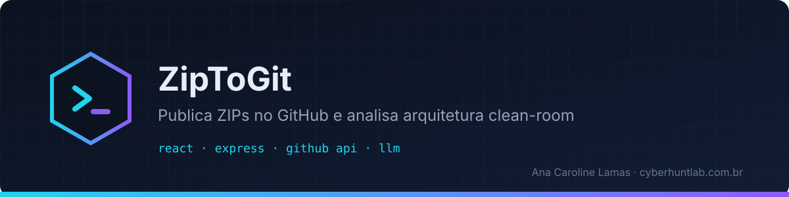

<p align="center"></p>

# ZipToGit — publicação de ZIP no GitHub e análise de arquitetura clean-room

<!-- vercel-demo:start -->
<p align="center"><a href="https://ziptogithub.vercel.app"></a></p>
<!-- vercel-demo:end -->

Aplicação full-stack (**React + Vite** no front-end e **Express** no back-end) que **publica o conteúdo de arquivos compactados direto num repositório do GitHub**, pelo navegador, e faz uma **análise técnica clean-room** de pacotes como ZIP e APK. Com um modelo de linguagem, ela gera um relatório de arquitetura e uma especificação para reimplementar o projeto de forma independente, sem copiar código, design ou marcas de terceiros.

## Recursos

- **Envio de pacotes**: arrastar e soltar, com identificação do formato por *magic bytes* (ZIP, TAR.GZ, RAR, 7z, APK, executáveis).
- **Árvore de arquivos** com pré-visualização e filtro de pastas como `node_modules`, `.git` e builds.
- **Publicação no GitHub** com token pessoal:
  - cria ou atualiza o repositório e a branch escolhidos;
  - pipeline de envio com progresso;
  - arquivos acima de 25 MB ficam de fora, por causa do limite da API.
- **Análise de arquitetura** (`POST /api/analyze-architecture`): relatório técnico e especificação clean-room gerados por IA.
- **Validação do pacote** (`POST /api/validate-package`) antes do envio.
- **Padronização de README** (`POST /api/rebrand-readme`): atualiza o nome do projeto e gera um README profissional, com comparação lado a lado.
- **Auditoria de prompts**: move prompts fixos no código para variáveis de ambiente e cria stubs para testar offline com LLMs locais.
- **Proteções de segurança**:
  - bloqueio de *Zip Slip* (caminhos `..` e absolutos);
  - limite de 2 GB descompactados contra zip bomb;
  - no máximo 3 níveis de arquivos aninhados.
- **Vários provedores de IA**: NVIDIA NIM, OpenAI, DeepSeek, Groq, Gemini ou Ollama local.

## Instalação

Requisitos: **Node.js 20+** e npm.

```bash
git clone https://github.com/ticarollamas-arch/ziptogithub.git
cd ziptogithub
npm install
cp .env.example .env
```

| Variável | Uso |
|---|---|
| `NVIDIA_API_KEY` | NVIDIA NIM (Llama 3.3, Mistral, DeepSeek) |
| `OPENAI_API_KEY`, `DEEPSEEK_API_KEY`, `GROQ_API_KEY`, `GEMINI_API_KEY` | Outros provedores (opcionais) |
| `OLLAMA_BASE_URL` | Ollama local, sem chave (padrão `http://localhost:11434/v1`) |
| `PORT` | Porta do servidor (padrão `3000`) |
| `ALLOW_LOCAL_AI` | Libera URLs de IA locais/privadas; por padrão só fora da Vercel |

As rotas de IA rodam tanto no `server.ts` (Express) quanto como funções da Vercel em `api/`, com a mesma lógica em `lib/handlers.ts`.

## Como usar

```bash
npm run dev        # servidor Express + Vite em http://localhost:3000
npm run build      # build de produção do front-end
npm run lint       # checagem de tipos
```

1. Envie um arquivo compactado e confira a árvore de arquivos.
2. Para publicar, informe um token do GitHub com permissão de escrita em *Contents*, o repositório e a branch.
3. Para analisar, escolha o provedor de IA e gere o relatório e a especificação clean-room.

## Produto pronto para vender

O app já vem com área de clientes, painel administrativo e integração com **Kiwify** e **Hotmart**:

| Página | O que faz |
|---|---|
| `/precos` | Planos e preços (editáveis no admin), com botões de checkout Kiwify/Hotmart |
| `/obrigado` | Página pós-pagamento com os próximos passos (configure como página de obrigado do produto) |
| `/entrar` | Login do cliente e **primeiro acesso**: e-mail da compra + código do pedido + senha |
| `/admin` | Clientes, liberar/revogar acesso, planos e preços, URLs dos webhooks e eventos |

**Como o acesso é liberado:** a Kiwify/Hotmart chama `/api/webhook`, o sistema confere a assinatura e libera o e-mail do comprador. O cliente cria a senha em `/entrar` usando o código do pedido (isso impede que outra pessoa "pegue" a conta só sabendo o e-mail). Reembolso, chargeback ou cancelamento bloqueiam o acesso automaticamente; planos mensais/anuais expiram sozinhos se não houver renovação.

### Configuração na Vercel

1. **Storage → Upstash Redis** (grátis): cria `KV_REST_API_URL` e `KV_REST_API_TOKEN`.
2. Em **Settings → Environment Variables**:

| Variável | Para que serve |
|---|---|
| `SESSION_SECRET` | Assina as sessões. Gere com `openssl rand -base64 48` |
| `ADMIN_EMAIL` / `ADMIN_PASSWORD` | Login do painel `/admin` (senha com 12+ caracteres) |
| `KIWIFY_TOKEN` | Token do webhook da Kiwify |
| `HOTMART_HOTTOK` | Hottok da Hotmart (Ferramentas → Webhook) |
| `KIT_NAMESPACE` | Prefixo no banco (padrão `ziptogit`), permite usar um banco para vários produtos |

3. Entre em `/admin`, cadastre os planos com os links de checkout e copie as URLs dos webhooks da aba **Kiwify / Hotmart**.

### Segurança

- Senhas com **scrypt**; sessão em cookie `HttpOnly`, `Secure`, `SameSite=Lax`, assinado com HMAC e revalidado no banco a cada requisição.
- Ações que mudam dados exigem JSON + cabeçalho próprio (proteção contra CSRF).
- Limite de tentativas por IP e por conta no login e no primeiro acesso.
- Webhooks com verificação de assinatura (HMAC-SHA1 na Kiwify, Hottok na Hotmart), comparação em tempo constante e proteção contra reenvio duplicado.
- As rotas pagas da API exigem assinatura ativa no servidor — esconder a tela não basta para burlar.
- URL de IA personalizada nunca recebe as chaves do servidor e não pode apontar para a rede interna (proteção contra SSRF e vazamento de chave).
- Chaves `NVIDIA_*` não são mais embutidas no JavaScript público.
- Cabeçalhos de segurança (CSP, HSTS, `X-Frame-Options`, `nosniff`) em `vercel.json`.

Testes do kit: `npm test` (roda sem internet, com banco em memória).

## Uso responsável

Analise apenas pacotes próprios ou com autorização do titular. A especificação gerada serve para uma implementação original: não remova créditos, avisos de licença ou direitos autorais de código de terceiros.

## Tecnologias

TypeScript · React 19 · Vite · Tailwind CSS v4 · Motion · Express · JSZip · GitHub REST API · NVIDIA NIM · OpenAI · DeepSeek · Groq · Gemini · Ollama

## Licença

Distribuído sob a licença MIT. Veja [LICENSE](LICENSE).
